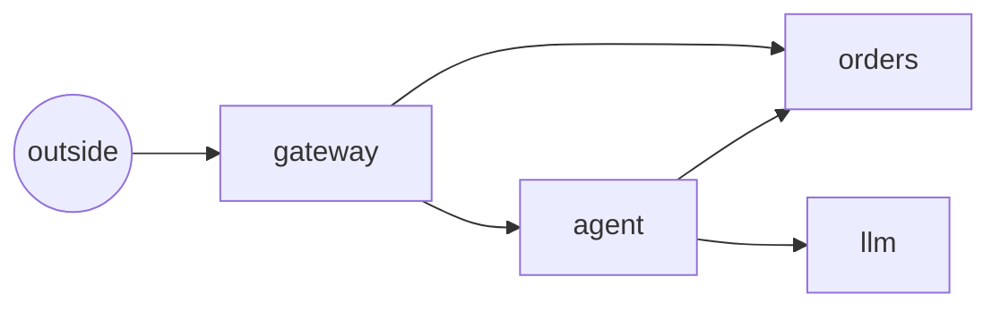

A **formation** is the unit a user deploys: a set of components that belong together, the calls
allowed between them, and which of them the outside can reach. Domain: `weft.formations`
([`ess/4-applications/formations.yaml`](https://github.com/beyond10x/weft/blob/main/ess/4-applications/formations.yaml)).

:::info[Specified, not built]
This page describes the specification. No running weft deploys a formation yet.
:::

## What a formation holds

| Element | What it is |
|---|---|
| Formation | Named, in one account. Owns a private network, a secret scope and a quota slice. States: `Active`, `Retired`. |
| Formation revision | An immutable snapshot of the formation's document. Every change is a new revision. |
| Component | One workload of the formation ([workloads](workloads.md)). |
| Link | An allowed call from one component to another, on one protocol and port. Components without a link cannot reach each other. |
| Border | The components reachable from outside the formation, through their endpoints and routes. Everything else is internal. |
| Endpoint, route | A public endpoint and the routes to a component and port behind it (host and path), what a Kubernetes Ingress says. |
| Internal name | Each component's DNS name in the formation's private network, for example `orders.shop.internal`. A link is what lets a caller resolve and reach it. |
| Config | Named non-secret data, mounted into components as files or environment variables, what a Kubernetes ConfigMap says. |
| Environment | A named target of the same formation (`dev`, `staging`, `prod`), each with its own secrets, config values, quotas and scale settings. |
| Export | One endpoint shared with another account of the same tenant. |

## The document is the topology

Changing the border, adding a link or splitting a component is an edit of the document and a new
revision. This is the example of the design sketch:

```yaml
formation: shop
components:
  gateway: { package: { kind: image, ref: ghcr.io/acme/gw@sha256:... }, shape: service }
  orders:  { package: { kind: ess-system, ref: ./orders/system.yaml }, shape: service }
  agent:   { package: { kind: agent, ref: ./support-agent.yaml }, shape: service }
  llm:     { package: { kind: model, ref: qwen3-32b }, shape: service,
             claims: { gpu: { model: nvidia-h100, count: 1 } } }
links:
  - gateway -> orders
  - gateway -> agent
  - agent -> orders
  - agent -> llm
border: [gateway]
```

`gateway` is the only component reachable from outside. `orders` is reachable from `gateway` and
`agent`; `llm` only from `agent`.



The format of this document is not fixed yet: the specification holds the formation's elements as
entities and commands, and the document format belongs to the planned `weft` CLI
([deploy a workload](../run/deploy-a-workload.md)).

## Deployment sources

A user deploys a **deployment source**, which a translator turns into a formation revision
(`weft.deployments`). Specified kinds: weft's own formation document, a Docker Compose file, a
Helm chart, Kubernetes manifests, an ESS system and an agent document. A translation is
deterministic and reports every object of the source as mapped, mapped with loss, or refused with
a reason; a refused object stops the deploy. A translator never grants more than the source
declares.

A **release** applies a formation revision to an environment. Before it applies, a **plan** shows
the difference to the live release and a **simulation** checks placement, policy and reachability.
