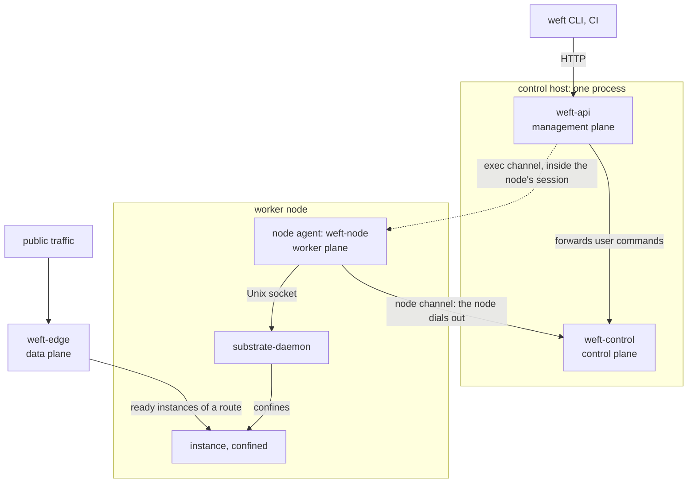

Domains: `weft.infrastructure` (the cloud itself), `weft.nodes` (the control plane's record of
each node's session), `weft.node` (the node agent's own records), `weft.scheduling` and
`weft.cluster` (tenant clusters).

:::info[Specified, not built]
This page describes the specification. No release of a control host or node agent exists yet
([Run weft](../run/control-host-and-node.md) is planned).
:::

## The cloud

| Entity | What |
|---|---|
| Cloud | The installation itself, with its access mode. |
| Zone | A failure domain. |
| Node pool | A template for nodes: machine type, image, minimum and maximum size, zone. |
| Node | One machine: role `control`, `worker` or both, its join, and what its node agent observed. |

A node's lifecycle:

| State | Meaning |
|---|---|
| `Provisioning` | created from a pool, not joined |
| `Joining` | presenting its join token |
| `Ready` | takes instances |
| `Cordoned` | takes no new instances |
| `Draining` | its instances move away |
| `Gone` | removed |

## Node agent and control plane

Each worker runs a node agent (`weft-node`). It dials out to `weft-control` over mutual TLS and
keeps one long-lived session; a worker opens no inbound port. Exec, attach, logs and port
forwarding from the CLI run inside that session, never as a direct connection to the node.

*Planned: drawn from [ess/components.yaml](https://github.com/beyond10x/weft/blob/main/ess/components.yaml) and [docs/implementation.md](https://github.com/beyond10x/weft/blob/main/docs/implementation.md); neither binary is built.*

| Direction | Messages |
|---|---|
| control plane to agent | assign, stop, pause, snapshot, drain, attach, detach, issue identity, deliver secret |
| agent to control plane | heartbeat, instance observed, node observed, usage reported |

The agent reports what it observed, never what it was told. An assignment has a lease: when a node
stops sending heartbeats, its session is lost, the leases end and its instances are scheduled
elsewhere. The times the control plane decides on are stamped by the control plane on receipt,
never taken from the node's message.

The session is specified as a protocol in
[`protocols/node-channel.yaml`](https://github.com/beyond10x/weft/blob/main/protocols/node-channel.yaml),
the exec stream in
[`protocols/exec-channel.yaml`](https://github.com/beyond10x/weft/blob/main/protocols/exec-channel.yaml).

## Reconciliation

weft keeps desired state (a live release, a scale setting, a claim) and observed state (what node
agents report) apart. A controller, a system actor such as the `Scheduler` or the `ControlPlane`,
reacts to a difference with a command that moves the observed state toward the desired one. Each
reaction is an ESS binding in
[`ess/components.yaml`](https://github.com/beyond10x/weft/blob/main/ess/components.yaml). Examples:

| Loop | Reacts to | With |
|---|---|---|
| R1 | a rollout step started, a service below its scale | request replicas |
| R2 | an instance exited under a restart policy | a new instance, with backoff |
| R3 | a node session lost, a lease ended | evict and reschedule its instances |
| R4 | a placement bound | send the assignment to the node |
| R8 | a wake requested; a wake deadline missed | schedule an instance; a named failure |

weft-sim drives these loops in its experiments ([run weft-sim](../simulator/run.md)).

## Clusters

A **cluster** is where workloads deploy. The cloud has a default cluster, owned by no account. An
account can create clusters of its own, with dedicated node pools and a **topology**: groups of
pools and the links between groups, including links workloads may not cross. The scheduler keeps
an instance's peers on the groups the topology allows.
