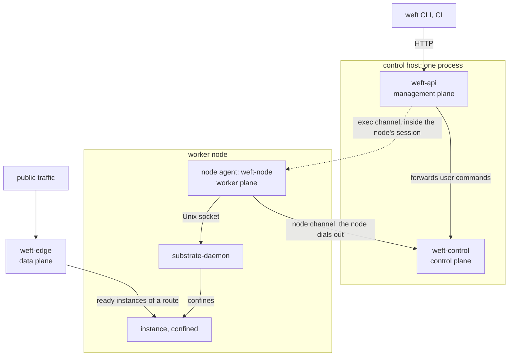

weft is a compute cloud a team deploys on its own machines: one control plane and any number of
worker nodes that run confined workloads. A workload can be a code snippet, a container image, a
virtual machine, a model, an [ESS](https://beyond10x.github.io/ess/) system or an agent. Workloads
claim GPUs, disks, network addresses and secrets. Tenants, nested accounts, tenant clusters and
quotas keep users apart. Isolation is the default: no egress, no secrets and no traffic between
components unless it is declared and allowed.

## What exists today

weft is built specification first. Each part is written as an ESS document before any code
implements it.

| Part | Where | Status |
|---|---|---|
| The domain model: 28 domains in 10 layers of weft's own files over cloudspec's vendored blocks | [`ess/`](https://github.com/beyond10x/weft/tree/main/ess) | Exists, valid |
| Components and reconciliation bindings: `weft-api`, `weft-control`, `weft-node`, `weft-edge` | [`ess/components.yaml`](https://github.com/beyond10x/weft/blob/main/ess/components.yaml) | Exists, valid |
| The node channel and the exec channel | [`protocols/`](https://github.com/beyond10x/weft/tree/main/protocols) | Exists |
| cloudspec-sim: explores and simulates the specification in memory; a tool of cloudspec at a pinned revision | [`crates/cloudspec-sim`](https://github.com/beyond10x/cloudspec/tree/2ed72c2866bbd165da2de75250b2bfcb340a96ae/crates/cloudspec-sim) | Exists |
| Experiments: a full setup, node loss, duplicate delivery and others | [`sim/experiments/`](https://github.com/beyond10x/weft/tree/main/sim/experiments) | Exist |
| The gate, `task check` | [`Taskfile.yml`](https://github.com/beyond10x/weft/blob/main/Taskfile.yml) | Runs on every change |
| HTTP API and CLI surfaces | none yet | Planned |
| Control host binary `weft`, node agent `weft-agent`: a walking skeleton, no release | [`product/cloud/`](https://github.com/beyond10x/weft/tree/main/product/cloud) | Planned |
| `weft` CLI | none yet | Planned |

No release of a control host or node agent exists, and no `weft` CLI. Pages about running weft
carry a **Planned** banner and describe the intended design, not something you can install.

## Planned implementation

The plan, not yet built:

- weft's domains in Rust, generated by ESS from the specification;
- a control host binary that runs `weft-api` and `weft-control`;
- a node agent, `weft-node`, built on substrate;
- ESS systems deployed as workloads and run by [Spindle](https://beyond10x.github.io/spindle/).

## The planes

The specification splits weft into four planes and four server components
([concepts: nodes and clusters](concepts/nodes-and-clusters.md)):

| Plane | Component | Does |
|---|---|---|
| Management | `weft-api` | The user API: logins, tokens, tenants, accounts, formations. Called by the CLI and by CI. |
| Control | `weft-control` | State, scheduling, identity, secret delivery; translation is cloudspec's. Decides; runs no workload. |
| Worker | `weft-node` | One agent per node; starts, observes and stops instances. Holds no state the control plane does not know. |
| Data | `weft-edge` | The gateway in front of public endpoints; holds a request while a sleeping service wakes. |

*Planned: drawn from [ess/components.yaml](https://github.com/beyond10x/weft/blob/main/ess/components.yaml) and [docs/implementation.md](https://github.com/beyond10x/weft/blob/main/docs/implementation.md); neither binary is built.*

## Where to go next

- [Getting started](getting-started.md): validate the specification and run cloudspec-sim.
- [Concepts](concepts/tenants-and-accounts.md): tenants, accounts, formations, workloads, claims,
  nodes and clusters.
- [Read the specification](specification/read.md): the files, a domain, a command.
- [Status](status.md): what exists and what is planned.
