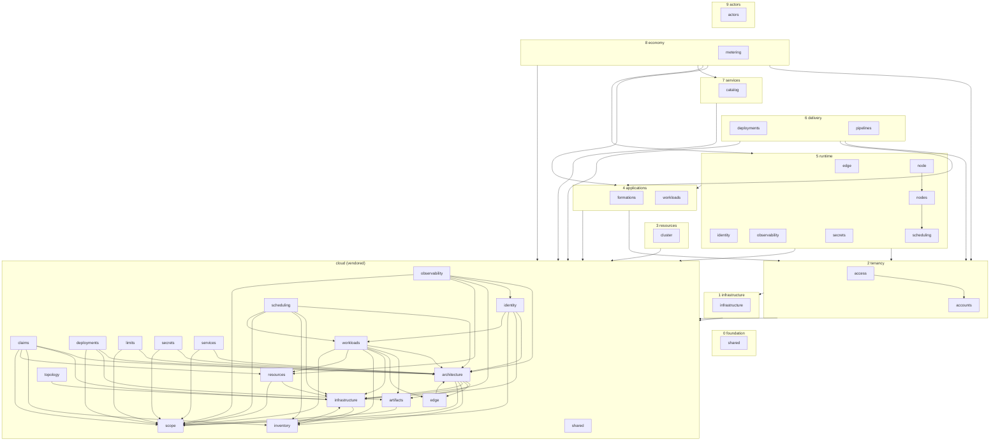

weft's own domain files sit in 10 layers, one directory each under `ess/`. Below them sits the
vendored layer `cloud`: the files under `ess/cloud/`, a copy of cloudspec's blocks. A file of
weft's own names only its own layer, a lower one or the vendored layer; a vendored file names no
file of weft's own. So no reference points to a higher layer. The layers of weft's own files were derived
from the references the domains make
([`docs/layers.md`](https://github.com/beyond10x/weft/blob/main/docs/layers.md)).

| Layer | Directory | Domains |
|---|---|---|
| 0 foundation | `ess/0-foundation/` | `shared`: the identifiers and value types of weft's own domains |
| 1 infrastructure | `ess/1-infrastructure/` | `infrastructure` (`CloudRuntime`: a cloud's access mode and control plane) |
| 2 tenancy | `ess/2-tenancy/` | `accounts`, `access` |
| 3 tenant resources | `ess/3-resources/` | `cluster` (tenant clusters) |
| 4 applications | `ess/4-applications/` | `formations`, `workloads` |
| 5 runtime | `ess/5-runtime/` | `scheduling`, `nodes`, `node`, `identity`, `secrets`, `observability`, `edge` |
| 6 delivery | `ess/6-delivery/` | `deployments`, `pipelines` |
| 7 services | `ess/7-services/` | `catalog` (managed services, products) |
| 8 economy | `ess/8-economy/` | `metering` |
| 9 actors | `ess/9-actors/` | `actors`: every actor; names commands of all layers |
| cloud (vendored) | `ess/cloud/` | `shared`, `infrastructure`, `inventory`, `topology`, `scope`, `resources`, `artifacts`, `workloads`, `claims`, `scheduling`, `identity`, `secrets`, `observability`, `limits`, `edge`, `services`, `architecture`, `deployments` |

A domain may be split over a vendored file and a file of weft's own: `weft.workloads` is
cloudspec's workloads under `ess/cloud/5-workloads/` and weft's run-time records under
`ess/4-applications/`. The vendored file sits in the vendored layer, so it may not name weft's
part.

The files under `ess/cloud/` are vendored: nobody edits them. They change only by
`task vendor-update REV=<commit>`, which copies cloudspec's blocks at that commit and pins it in
`ess/cloud/cloud.lock`; the gate refuses a vendored file whose digest differs from the lock.

## The domain map

One box per layer, one node per part of a domain one layer declares: `cloud.workloads` is the
vendored part of `weft.workloads`, `workloads` in layer 4 weft's own. A part refers to another
through an entity field or a declared relation. An arrow between two boxes means that a part of
the upper layer refers to a part of the lower one; an arrow inside a box joins a part to another
of that layer. The table after the figure names, for each part, every part it refers to. The map
and the table are generated from `ess/` by `tools/gen-domain-map.sh`, and the gate fails when they
differ from the specification.

<!-- domain-map -->
<!-- Generated by tools/gen-domain-map.sh from ess/; do not edit. -->



| Layer | Domain | Refers to |
|---|---|---|
| 9 | `actors` | none |
| 8 | `metering` | `cloud.architecture`, `cloud.edge`, `cloud.infrastructure`, `cloud.inventory`, `cloud.resources`, `cloud.scope`, `cloud.services`, `accounts`, `catalog`, `nodes`, `workloads` |
| 7 | `catalog` | `cloud.architecture`, `cloud.deployments`, `cloud.inventory`, `cloud.scope`, `cloud.services` |
| 6 | `deployments` | `cloud.architecture`, `cloud.deployments`, `cloud.infrastructure`, `cloud.scope`, `cloud.workloads`, `accounts`, `workloads` |
| 6 | `pipelines` | `cloud.architecture`, `cloud.artifacts`, `cloud.deployments`, `cloud.inventory`, `cloud.resources`, `cloud.scope`, `cloud.secrets`, `accounts`, `workloads` |
| 5 | `edge` | `cloud.architecture`, `cloud.edge`, `cloud.workloads`, `workloads` |
| 5 | `identity` | none |
| 5 | `node` | `cloud.infrastructure`, `nodes`, `workloads` |
| 5 | `nodes` | `cloud.claims`, `cloud.infrastructure`, `cloud.inventory`, `cloud.scope`, `cloud.workloads`, `accounts`, `scheduling`, `workloads` |
| 5 | `observability` | `cloud.observability`, `cloud.scope` |
| 5 | `scheduling` | `cloud.architecture`, `cloud.claims`, `cloud.infrastructure`, `cloud.scheduling`, `cloud.scope`, `cloud.topology`, `accounts`, `workloads` |
| 5 | `secrets` | `cloud.identity`, `cloud.secrets`, `workloads` |
| 4 | `formations` | `cloud.edge`, `cloud.scope`, `accounts` |
| 4 | `workloads` | `cloud.artifacts`, `cloud.infrastructure`, `cloud.scope`, `cloud.workloads` |
| 3 | `cluster` | `cloud.architecture`, `cloud.infrastructure`, `cloud.scope` |
| 2 | `access` | `cloud.infrastructure`, `cloud.scope`, `accounts`, `infrastructure` |
| 2 | `accounts` | `cloud.inventory`, `cloud.scope` |
| 1 | `infrastructure` | `cloud.infrastructure` |
| 0 | `shared` | none |
| cloud | `cloud.architecture` | `cloud.artifacts`, `cloud.edge`, `cloud.infrastructure`, `cloud.inventory`, `cloud.scope` |
| cloud | `cloud.artifacts` | `cloud.scope` |
| cloud | `cloud.claims` | `cloud.architecture`, `cloud.infrastructure`, `cloud.inventory`, `cloud.resources`, `cloud.scope` |
| cloud | `cloud.deployments` | `cloud.architecture`, `cloud.artifacts`, `cloud.scope` |
| cloud | `cloud.edge` | `cloud.architecture` |
| cloud | `cloud.identity` | `cloud.architecture`, `cloud.infrastructure`, `cloud.scope`, `cloud.workloads` |
| cloud | `cloud.infrastructure` | `cloud.inventory` |
| cloud | `cloud.inventory` | `cloud.infrastructure` |
| cloud | `cloud.limits` | `cloud.architecture`, `cloud.scope` |
| cloud | `cloud.observability` | `cloud.architecture`, `cloud.identity`, `cloud.infrastructure`, `cloud.resources`, `cloud.scope` |
| cloud | `cloud.resources` | `cloud.infrastructure`, `cloud.scope` |
| cloud | `cloud.scheduling` | `cloud.architecture`, `cloud.infrastructure`, `cloud.inventory`, `cloud.scope`, `cloud.workloads` |
| cloud | `cloud.scope` | none |
| cloud | `cloud.secrets` | `cloud.architecture`, `cloud.scope` |
| cloud | `cloud.services` | `cloud.architecture`, `cloud.scope` |
| cloud | `cloud.shared` | none |
| cloud | `cloud.topology` | `cloud.infrastructure` |
| cloud | `cloud.workloads` | `cloud.architecture`, `cloud.artifacts`, `cloud.edge`, `cloud.infrastructure`, `cloud.inventory`, `cloud.resources`, `cloud.scope` |
<!-- /domain-map -->

## What the rule costs

A lower layer cannot read a higher one. Two examples from the specification:

- A claim names a node and an instance, so `claims` sits in layer 5, above `resources` in layer 3.
  Deleting a volume that a claim still binds is refused as an outcome the `resources` domain
  cannot decide itself, because layer 3 cannot read claims.
- An instance no longer records its placement decision; the placement decision names the instance
  instead, so `workloads` (layer 4) does not refer upward to `scheduling` (layer 5).

## Check it

```shell-session
$ tools/check-layers.sh
```

fails on any reference to a higher layer. It runs in the gate as `task layers`.
`task graph` prints the reference graph between domains with counts, then runs the same check.
