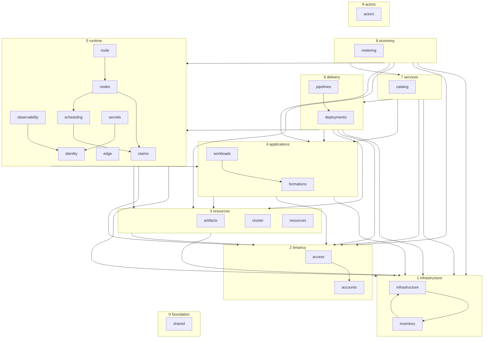

The domains of weft sit in 10 layers, one directory each under `ess/`. A domain names only
domains of its own layer or a lower one, so the references between domains form no cycle. The
layers were derived from the references the domains make
([`docs/layers.md`](https://github.com/beyond10x/weft/blob/main/docs/layers.md)).

| Layer | Directory | Domains |
|---|---|---|
| 0 foundation | `ess/0-foundation/` | `shared`: every entity identifier and the value types more than one domain uses |
| 1 infrastructure | `ess/1-infrastructure/` | `infrastructure` (clouds, zones, node pools, nodes), `inventory` (resource classes, devices) |
| 2 tenancy | `ess/2-tenancy/` | `accounts`, `access` |
| 3 tenant resources | `ess/3-resources/` | `resources` (volumes, filesystems, buckets, snapshots), `artifacts`, `cluster` (tenant clusters) |
| 4 applications | `ess/4-applications/` | `formations`, `workloads` |
| 5 runtime | `ess/5-runtime/` | `claims`, `scheduling`, `nodes`, `node`, `identity`, `secrets`, `observability`, `edge` |
| 6 delivery | `ess/6-delivery/` | `deployments`, `pipelines` |
| 7 services | `ess/7-services/` | `catalog` (managed services, products) |
| 8 economy | `ess/8-economy/` | `metering` |
| 9 actors | `ess/9-actors/` | `actors`: every actor; names commands of all layers |

## The domain map

One box per layer, one node per domain. A domain refers to another through an entity field or a
declared relation. An arrow between two boxes means that a domain of the upper layer refers to a
domain of the lower one; an arrow inside a box joins a domain to another of that layer. The table after
the figure names, for each domain, every domain it refers to. The map and the table are generated
from `ess/` by `tools/gen-domain-map.sh`, and the gate fails when they differ from the
specification.

<!-- domain-map -->
<!-- Generated by tools/gen-domain-map.sh from ess/; do not edit. -->



| Layer | Domain | Refers to |
|---|---|---|
| 9 | `actors` | none |
| 8 | `metering` | `accounts`, `catalog`, `formations`, `infrastructure`, `inventory`, `nodes`, `resources`, `workloads` |
| 7 | `catalog` | `accounts`, `deployments`, `formations`, `inventory` |
| 6 | `deployments` | `accounts`, `artifacts`, `formations`, `infrastructure`, `workloads` |
| 6 | `pipelines` | `accounts`, `artifacts`, `deployments`, `formations`, `inventory`, `resources`, `secrets`, `workloads` |
| 5 | `claims` | `accounts`, `formations`, `infrastructure`, `inventory`, `resources`, `workloads` |
| 5 | `edge` | `formations`, `workloads` |
| 5 | `identity` | `accounts`, `formations`, `infrastructure`, `workloads` |
| 5 | `node` | `infrastructure`, `nodes`, `workloads` |
| 5 | `nodes` | `accounts`, `claims`, `infrastructure`, `inventory`, `scheduling`, `workloads` |
| 5 | `observability` | `accounts`, `formations`, `identity`, `infrastructure`, `resources`, `workloads` |
| 5 | `scheduling` | `accounts`, `claims`, `cluster`, `formations`, `infrastructure`, `inventory`, `workloads` |
| 5 | `secrets` | `accounts`, `formations`, `identity`, `workloads` |
| 4 | `formations` | `accounts`, `artifacts`, `cluster`, `infrastructure`, `inventory` |
| 4 | `workloads` | `accounts`, `artifacts`, `formations`, `infrastructure`, `inventory`, `resources` |
| 3 | `artifacts` | `accounts` |
| 3 | `cluster` | `accounts`, `infrastructure` |
| 3 | `resources` | `accounts`, `infrastructure` |
| 2 | `access` | `accounts`, `infrastructure` |
| 2 | `accounts` | `inventory` |
| 1 | `infrastructure` | `inventory` |
| 1 | `inventory` | `infrastructure` |
| 0 | `shared` | none |
<!-- /domain-map -->

## What the rule costs

A lower layer cannot read a higher one. Two examples from the specification:

- A claim names a node and an instance, so `claims` sits in layer 5, above `resources` in layer 3.
  Deleting a volume that a claim still binds is refused as an outcome the `resources` domain
  cannot decide itself, because layer 3 cannot read claims.
- An instance no longer records its placement decision; the placement decision names the instance
  instead, so `workloads` (layer 4) does not refer upward to `scheduling` (layer 5).

## Check it

```shell-session
$ tools/check-layers.sh
```

fails on any reference to a higher layer. It runs in the gate as `task layers`.
`task graph` prints the reference graph between domains with counts, then runs the same check.
